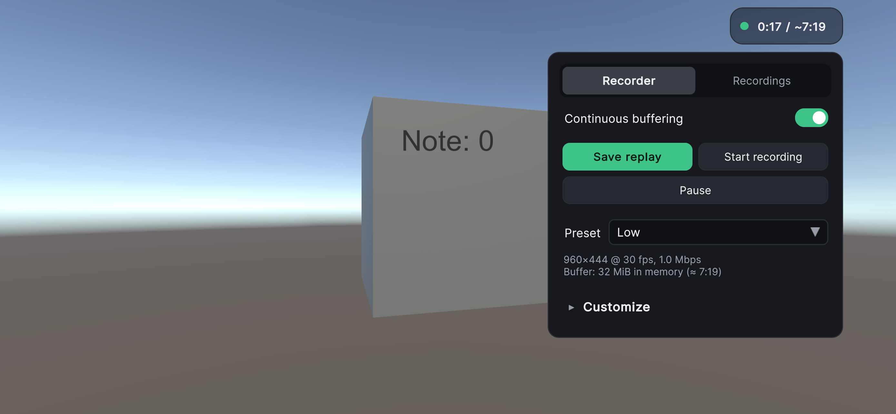
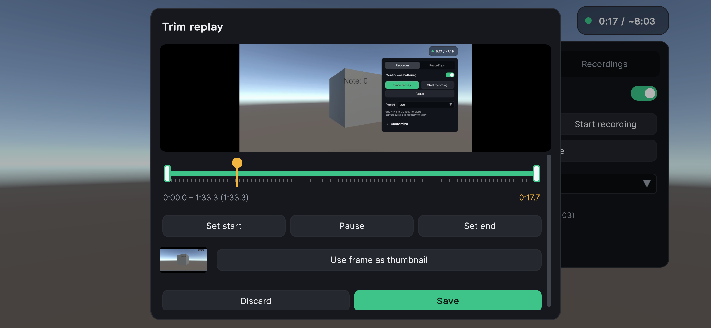
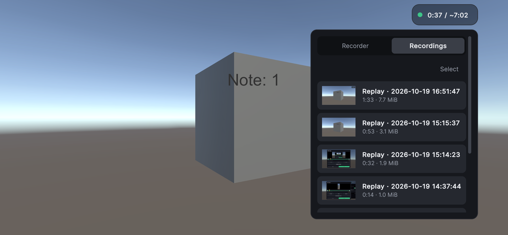
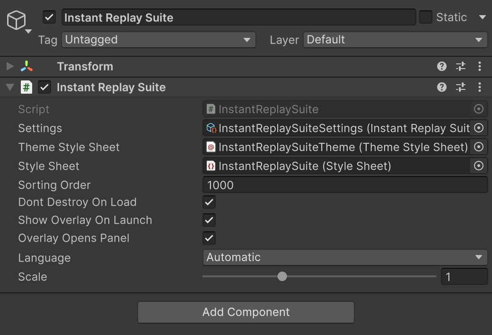
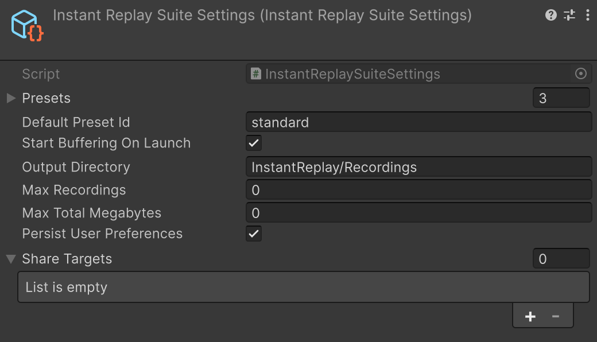
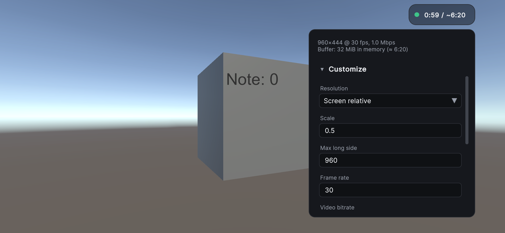
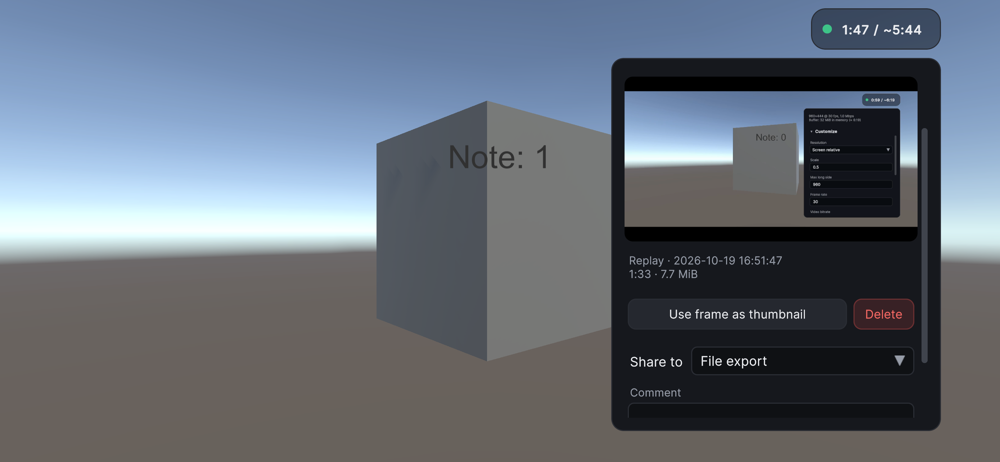

# Instant Replay for Unity

[](LICENSE)
[](https://github.com/CyberAgentGameEntertainment/InstantReplay/pulls)
[](#installation)

[日本語](README.ja.md)

Instant Replay is a Unity library for saving recent gameplay footage on demand.
It maintains a rolling buffer, so you can save important moments even after they happen. Recording is limited to a preconfigured duration, and frames older than that limit are discarded.

### For Sharing Gameplay on Social Media

You can implement a feature that allows users to share their recent gameplay footage on social media.

### For Recording Bug Reproduction Steps

When a bug occurs, you can export the recent gameplay leading up to the bug as a video, which can help reproduce it.

## Table of Contents

<!-- TOC -->
* [Instant Replay for Unity](#instant-replay-for-unity)
  * [Table of Contents](#table-of-contents)
  * [Requirements](#requirements)
    * [Encoder APIs in use](#encoder-apis-in-use)
  * [Installation](#installation)
    * [Install Dependencies](#install-dependencies)
      * [Method 1: Install via UnityNuGet and dependency package](#method-1-install-via-unitynuget-and-dependency-package)
      * [Method 2: Install manually](#method-2-install-manually)
    * [Install the Package](#install-the-package)
  * [Quick Start](#quick-start)
  * [Instant Replay Suite](#instant-replay-suite)
    * [Setup](#setup)
    * [Using the Suite on Web](#using-the-suite-on-web)
    * [Using the User Interface](#using-the-user-interface)
      * [Overlay](#overlay)
      * [Recorder Tab](#recorder-tab)
      * [Trim View](#trim-view)
      * [Recordings Tab](#recordings-tab)
      * [Recovering Unfinished Recordings](#recovering-unfinished-recordings)
    * [Using the Suite from Code](#using-the-suite-from-code)
      * [Saving a Replay](#saving-a-replay)
      * [Starting an Unbounded Recording](#starting-an-unbounded-recording)
      * [State and Statistics](#state-and-statistics)
      * [Choosing Video and Audio Sources](#choosing-video-and-audio-sources)
      * [Recording Library](#recording-library)
      * [Sharing](#sharing)
      * [Showing the Suite Views from Your Own Screens](#showing-the-suite-views-from-your-own-screens)
      * [Using the Recorder without the User Interface](#using-the-recorder-without-the-user-interface)
  * [Detailed Usage](#detailed-usage)
    * [Options](#options)
    * [Pausing and Resuming](#pausing-and-resuming)
    * [Setting the Video Source](#setting-the-video-source)
      * [Built-in `IFrameProvider`](#built-in-iframeprovider)
      * [Custom `IFrameProvider` Implementation](#custom-iframeprovider-implementation)
    * [Setting the Audio Source](#setting-the-audio-source)
      * [CRI Support](#cri-support)
      * [Wwise Support](#wwise-support)
    * [Getting the Recording State](#getting-the-recording-state)
  * [Disk Buffering and Crash Recovery](#disk-buffering-and-crash-recovery)
    * [Recovering After a Crash](#recovering-after-a-crash)
    * [Disk Buffer Options](#disk-buffer-options)
  * [Unbounded Recording](#unbounded-recording)
  * [Legacy Mode](#legacy-mode)
    * [Setting Recording Time and Frame Rate](#setting-recording-time-and-frame-rate)
    * [Setting the Size](#setting-the-size)
    * [Video and Audio Sources](#video-and-audio-sources)
  * [Excluding from the Release Builds](#excluding-from-the-release-builds)
  * [License](#license)
<!-- TOC -->

## Requirements

- Unity 2022.3 or later

> [!NOTE]
> The following information is based on the APIs and platform tools being used, and actual functionality may not have been verified.

Platform|OS version|aarch64|x86_64|Other requirements
-|-|-|-|-
iOS|10.0+|✅|N/A|
Android|8.0+|✅|✅|
macOS|11.0+|✅|✅|
Windows|Windows 10+, Windows Server 2016+|-|✅|
Linux|kernel 3.2+, glibc 2.17+|-|✅|`ffmpeg` in PATH
Web|(any)|(any)|(any)|[Browser supports WebCodecs](#encoder-apis-in-use)

- For legacy mode, other platforms may work if `ffmpeg` is available in PATH.

>[!WARNING]
> **Known Issue with WebGL**: In WebGL, flickering may occur on the screen during recording. This is caused by `ScreenshotFrameProvider`, which is the default `IFrameProvider` implementation. If you encounter this issue, please use [`BuiltinCameraFrameProvider`](#built-in-iframeprovider) (for Built-in RP), [`RendererFeatureFrameProvider`](#built-in-iframeprovider) (for Universal RP), or another custom `IFrameProvider` implementation that provides input `RenderTexture` directly.

### Encoder APIs in use

Platform|APIs
-|-
iOS / macOS|Video Toolbox (H.264), Audio Toolbox (AAC)
Android|MediaCodec (H.264 / AAC)
Windows|Media Foundation (H.264 / AAC)
Linux|FFmpeg installed on the system (H.264 / AAC)
Web|[WebCodecs](https://caniuse.com/webcodecs) (`avc1.640028` for video, `mp4a.40.2` for audio)

## Installation

### Install Dependencies

You can install the dependencies using either of the following methods.

#### Method 1: Install via UnityNuGet and dependency package

[Add UnityNuGet scoped registry](https://github.com/xoofx/UnityNuGet#add-scope-registry-manifestjson) and add the following git URL to the Package Manager:

```
https://github.com/CyberAgentGameEntertainment/InstantReplay.git?path=/Packages/jp.co.cyberagent.instant-replay.dependencies#release
```

#### Method 2: Install manually

Install individual packages using [NuGetForUnity](https://github.com/GlitchEnzo/NuGetForUnity) or [UnityNuGet](https://github.com/bdovaz/UnityNuGet):

- [System.IO.Pipelines](https://www.nuget.org/packages/system.io.pipelines/)
- [System.Threading.Channels](https://www.nuget.org/packages/System.Threading.Channels)

### Install the Package

Add the following git URL to the Package Manager:

```
https://github.com/CyberAgentGameEntertainment/InstantReplay.git?path=Packages/jp.co.cyberagent.instant-replay#release
```

## Quick Start

Import the "User Interfaces" sample from the Package Manager.


Open `SampleScene` in the imported sample and enter Play mode. The scene contains a game object with the `InstantReplaySuite` component, which starts buffering the gameplay as soon as the scene starts.

The overlay at the top right of the screen by default shows the duration of the buffered footage and the estimated capacity of the buffer. Click or tap the overlay to open the panel.



Press **Save replay**. The trim view opens with the whole buffered footage selected. Press **Save** to save it as it is, or choose a range first as described in [Trim View](#trim-view).



The saved recording appears in the **Recordings** tab, where it can be played back, shared and deleted.



To use the suite in your own project, see [Instant Replay Suite](#instant-replay-suite). To record from your own code without the suite, see [Detailed Usage](#detailed-usage).

## Instant Replay Suite

The Instant Replay Suite is a set of runtime components and a user interface that is included in the package. It covers what projects commonly build on top of the recording API: continuous buffering, saving and trimming replays, unbounded recording, recording settings that the user can change at runtime, a library of saved recordings, sharing, and recovery of footage left behind by an abnormal termination.

The suite consists of the following assemblies.

| Assembly | Contents |
|---|---|
| `InstantReplay.Suite` | The recorder (`InstantReplayRecorder`), presets, the settings asset, the recording library, the sharing abstraction and the file export share target. It does not depend on any UI framework. |
| `InstantReplay.Suite.UI` | The `InstantReplaySuite` component and its UI Toolkit user interface. |
| `InstantReplay.Suite.Sharing.Slack` | Slack share target. Compiled only when the UnityWebRequest module is enabled. |
| `InstantReplay.Suite.Sharing.Discord` | Discord share target. Compiled only when the UnityWebRequest module is enabled. |

The preview of recordings requires the Video module, and thumbnails require the Image Conversion module. The corresponding controls are omitted when these modules are disabled. Preview is not available on WebGL, where `VideoPlayer` cannot open local files.

> [!NOTE]
> By default, the suite captures the screen with `ScreenshotFrameProvider`, so the overlay and the panel appear in the recordings. To exclude them, supply a camera-based frame provider as described in [Choosing Video and Audio Sources](#choosing-video-and-audio-sources).

### Setup

1. Add the `InstantReplaySuite` component to a game object in the first scene (**Add Component > Instant Replay > Instant Replay Suite**). Only one instance can be active at a time; a second instance destroys itself.
2. Create a settings asset from **Create > Instant Replay > Suite Settings** and assign it to the **Settings** field. Without a settings asset, the suite uses a single default preset.



| Field | Description |
|---|---|
| Settings | The `InstantReplaySuiteSettings` asset. |
| Theme Style Sheet, Style Sheet | Style sheets of the user interface. They are assigned automatically from the package in the editor. |
| Sorting Order | Sorting order of the panel that displays the user interface. |
| Dont Destroy On Load | Whether the game object is kept across scene loads. |
| Show Overlay On Launch | Whether the overlay is shown at startup. Recording continues while the overlay is hidden. |
| Overlay Opens Panel | Whether clicking or tapping the overlay opens the panel. When disabled, the overlay only shows the recording status and lets clicks and taps through. |
| Overlay Corner | Corner of the screen where the overlay is placed until the user chooses another one in the panel. |
| Language | Language of the user interface. `Automatic` uses Japanese when the system language is Japanese and English otherwise. |
| Fallback Font | Font used for the characters that the font of the theme lacks, such as Japanese. Required to show Japanese on Web. See [Using the Suite on Web](#using-the-suite-on-web). |
| Scale | Multiplier applied to the size of the user interface. |

The user interface keeps a constant physical size on every screen. One unit of the style sheet corresponds to 1/96 inch on desktop platforms and to 1/160 inch on handheld devices.



| Field | Description |
|---|---|
| Presets | Recording settings that the user can choose from. See below. |
| Default Preset Id | Identifier of the preset used until the user chooses one. |
| Start Buffering On Launch | Whether buffering starts at startup when the user has not chosen otherwise. |
| Output Directory | Directory where recordings are saved. Relative paths are resolved against `Application.persistentDataPath`. |
| Max Recordings | Number of recordings to keep. The oldest recordings are deleted beyond it. Zero keeps every recording. |
| Max Total Megabytes | Total size of the recordings to keep, in MiB. The oldest recordings are deleted beyond it, but the recording just saved is always kept. Zero keeps every recording. |
| Persist User Preferences | Whether the preset, the buffering toggle and the overlay position chosen by the user are restored at the next launch. |
| Share Targets | Destinations offered when the user shares a recording. See [Sharing](#sharing). |

Each preset has an identifier, a display name, the resolution (a fixed size, or a ratio of the screen size with an upper bound on the longer side), the frame rate, the video bitrate (a fixed value, or computed from bits per pixel), the audio bitrate, the buffer (in memory or on disk, with its size in MiB) and `ForceReadback`. The panel shows the duration that the buffer of the selected preset is estimated to hold.

### Using the Suite on Web

On Web (WebGL / WebGPU), the suite has the following limitations compared with the other platforms.

- Recordings are saved as browser downloads and do not remain in `Application.persistentDataPath`. The Recordings tab is therefore not shown, and `InstantReplaySuite.PickRecordingsAsync` throws `NotSupportedException`.
- The footage cannot be previewed, so the trim view is not available. **Save replay** saves the whole buffered footage. `InstantReplaySuite.TrimAsync` throws `NotSupportedException`.
- The disk buffer is not available. A preset with a disk buffer records with a memory buffer of the same size, and the panel does not offer the choice of the buffer kind.
- The fonts of the system are not available, so a font that contains Japanese characters must be assigned to **Fallback Font** to show Japanese. Without it, the user interface is shown in English regardless of the system language when **Language** is `Automatic`.

To assign a font:

1. Import a font file that contains Japanese characters, such as [Noto Sans JP](https://fonts.google.com/noto/specimen/Noto+Sans+JP), into the project.
2. Make sure that **Include Font Data** is enabled in the import settings of the font. It is enabled by default.
3. Assign the font to **Fallback Font** of the `InstantReplaySuite` component.

The font file is included in the build, and a dynamic font asset is created from it at runtime. Japanese fonts are large, so consider a subset font that contains only the characters shown in the user interface to keep the build small. **Fallback Font** is also used on the other platforms, where it takes precedence over the fonts of the system.

### Using the User Interface

#### Overlay

The overlay is always shown while it is enabled. It shows the state of the recorder with a colored dot and the buffered duration against the estimated capacity. During an unbounded recording, the dot turns red and blinks, and the overlay shows the elapsed time. Click or tap the overlay to open or close the panel. The corner of the screen where the overlay is placed can be changed with **Overlay position** in the panel, and the panel opens next to the overlay.

#### Recorder Tab

- **Continuous buffering** enables or disables buffering.
- **Save replay** takes the buffered footage and opens the [trim view](#trim-view). Buffering restarts immediately, so footage continues to be buffered while the trim view is open.
- **Start recording** starts an unbounded recording, which is written directly to a file until **Stop recording** is pressed. Buffering is suspended during an unbounded recording and resumes afterwards.
- **Pause** pauses buffering or the unbounded recording, and **Resume** resumes it.
- **Preset** selects one of the presets. Changing the preset discards the buffered footage.
- **Customize** overrides individual settings of the selected preset. The preset is then shown with "(custom)", and **Reset to preset** discards the overrides.



#### Trim View

The trim view plays the captured footage in a loop within the selected range.

- Drag the handles at both ends of the timeline to choose the range. The start snaps to the key frame where the saved recording actually starts. The ticks below the timeline mark the key frames.
- Drag the knob, or click elsewhere on the timeline, to move the playback position. **Set start** and **Set end** set the range at the playback position.
- **Use frame as thumbnail** takes the frame being shown as the thumbnail of the recording.
- **Save** saves the selected range to the library, and **Discard** closes the view without saving.

#### Recordings Tab

The Recordings tab lists the saved recordings, newest first. Select a recording to show its preview and details.



- **Use frame as thumbnail** replaces the thumbnail with the frame being shown in the preview.
- **Delete** deletes the recording. Press it again within three seconds to confirm.
- **Share to** selects a share target, **Comment** adds a message, and **Share** shares the recording. This section is shown when at least one share target is configured.
- **Select** switches the list to the selection mode, in which several recordings can be selected and deleted together.

#### Recovering Unfinished Recordings

When a preset with a disk buffer is used and the application terminates abnormally, the footage buffered on disk remains. On the next launch, the Recordings tab lists such footage under **Unfinished recordings**. **Recover** saves it to the library, and **Delete** discards it.

### Using the Suite from Code

The suite can be controlled from game code through `InstantReplayRecorder`, available as `InstantReplaySuite.Recorder`. `InstantReplaySuite.Current` returns the active instance. Every member of `InstantReplayRecorder` must be called on the main thread, and its events are raised on the main thread.

#### Saving a Replay

`SaveReplayAsync` saves the buffered footage to the library without user interaction.

```csharp
using System.Collections.Generic;
using InstantReplay.Suite;
using InstantReplay.Suite.UI;
using UnityEngine;

var recorder = InstantReplaySuite.Current.Recorder;
if (recorder.State == RecorderState.Buffering)
{
    var entry = await recorder.SaveReplayAsync(new ReplaySaveRequest
    {
        DurationSeconds = 30, // null saves the whole buffer
        Metadata = new Dictionary<string, string> { ["scene"] = "Stage1" }
    });
    Debug.Log($"Saved {entry.FilePath}");
}
```

`CaptureReplayAsync` takes the buffered footage without saving it and returns a `ReplayDraft`, from which any range can be saved any number of times. The caller owns the draft and must dispose it.

```csharp
using var draft = await recorder.CaptureReplayAsync();

// Saves the last ten seconds. The start moves to the key frame at or before the requested time.
var start = draft.GetSaveStart(Math.Max(0, draft.DurationSeconds - 10));
var entry = await draft.SaveAsync(start);
```

#### Starting an Unbounded Recording

```csharp
var recording = recorder.StartUnbounded();

// 〜 Gameplay 〜

var entry = await recording.StopAsync();
```

#### State and Statistics

`State` returns one of `Idle`, `Buffering`, `Exporting`, `RecordingUnbounded` and `Faulted`, and `StateChanged` is raised when it changes. `IsPaused` is independent of the state. The recorder also pauses while the application is suspended, so that the suspension does not appear in the footage as a period without frames; this does not change `IsPaused`. `GetStatistics()` returns the buffered duration, the estimated capacity, the bytes used by the buffer and the elapsed time of an unbounded recording.

The recorder can also be controlled with `SetBufferingEnabled`, `Pause`, `Resume` and `ApplyPreset`, which correspond to the controls of the Recorder tab.

#### Choosing Video and Audio Sources

By default, the suite uses `ScreenshotFrameProvider` and `UnityAudioSampleProvider`. To use other providers, configure them before the `Start` of the `InstantReplaySuite` component, for example in `Awake` of your own component.

```csharp
using InstantReplay;
using InstantReplay.Suite.UI;
using InstantReplay.UniversalRP;
using UnityEngine;

public class SuiteSetup : MonoBehaviour
{
    [SerializeField] private InstantReplaySuite suite;
    [SerializeField] private Camera gameCamera;

    private void Awake()
    {
        // Records only the game camera, so that the overlay and the panel do not appear in the recordings.
        suite.Recorder.SetFrameProviderFactory(() => new RendererFeatureFrameProvider(gameCamera));
    }
}
```

The recorder keeps at most one instance of each provider and passes the same instance to every session it creates, so a factory is called only when no instance exists. `SetFrameProvider` and `SetAudioSampleProvider` accept an instance created by the application; when `takeOwnership` is false, the recorder never disposes it. When a provider can no longer operate, for example because its camera has been destroyed, call `InvalidateFrameProvider` or `InvalidateAudioSampleProvider`.

#### Recording Library

`recorder.Library` manages the saved recordings. `GetEntries()` returns them newest first as `RecordingEntry` objects, which describe the file path, the creation time, the duration, the size, the source (`Replay`, `Unbounded` or `Recovered`), the metadata and the thumbnail path. `Delete` deletes recordings, and `Changed` is raised when the list changes. `ImportRecoveredAsync` saves footage returned by `DiskEncodedFrameBufferRecovery.FindRecoverable()` to the library.

#### Sharing

A share target is an asset derived from `ShareTarget`, listed in **Share Targets** of the settings asset. The package provides the following targets, each created from **Create > Instant Replay > Share Targets**.

| Target | Description |
|---|---|
| File Export | Copies the recording to a directory. Relative paths are resolved against `Application.persistentDataPath`. It can open the directory afterwards on desktop platforms. |
| Slack | Uploads the recording to a channel with a bot token that has the `files:write` scope. |
| Discord | Posts the recording to a channel through a webhook. The upload limit of the server is configurable (10 MiB by default). |

> [!WARNING]
> Tokens and webhook URLs configured in an asset are included in the build. The Slack and Discord targets are intended for development and quality-assurance builds. They also accept credentials set from code at runtime through `SlackShareTarget.Token` and `DiscordShareTarget.WebhookUrl`.

Share targets can also be added at runtime through `recorder.ShareTargets`. To support another destination, derive a class from `ShareTarget`.

```csharp
using System.Threading;
using System.Threading.Tasks;
using InstantReplay.Suite;
using UnityEngine;

[CreateAssetMenu(menuName = "My Game/Bug Tracker Share Target")]
public class BugTrackerShareTarget : ShareTarget
{
    public override bool CanShare(ShareRequest request, out string reason)
    {
        reason = null;
        return true;
    }

    public override async ValueTask<ShareResult> ShareAsync(ShareRequest request, ShareContext context,
        CancellationToken cancellationToken)
    {
        foreach (var entry in request.Entries)
        {
            // Upload entry.FilePath together with request.Comment and entry.Metadata, and report progress with
            // context.ReportProgress(0..1).
        }

        // Failures are reported by throwing; the message of the exception is shown to the user.
        return new ShareResult("Reported.", url: "https://example.com/issues/123");
    }
}
```

#### Showing the Suite Views from Your Own Screens

The trim view and a list of recordings can be shown from screens built by the application, such as a bug report screen in a debug menu. These views are shown even while the overlay is hidden, and they return what the user chose without saving anything or sharing it.

- `TrimAsync(draft)` shows the trim view for a `ReplayDraft` and returns a `ReplaySelection` that holds the chosen range and thumbnail, or null when the user cancels. The draft stays with the caller. `draft.ExportAsync(selection)` writes the range to a file outside the library, and `draft.SaveAsync(selection)` saves it to the library.
- `PickRecordingsAsync()` lists the recordings in the library together with footage left behind by abnormal terminations, and returns the recordings the user chose. Chosen footage of the latter kind is recovered into the library first. Pass `allowMultiple: false` to allow only one recording.

Only one of these views can be open at a time. Cancelling the `CancellationToken` passed to either method closes the view.

```csharp
using InstantReplay.Suite.UI;

var suite = InstantReplaySuite.Current;

// When the debug menu opens, so that the menu itself is not recorded. Footage can still be captured while paused.
suite.Recorder.Pause();

// In the bug report screen
using var draft = await suite.Recorder.CaptureReplayAsync();
var selection = await suite.TrimAsync(draft);
if (selection != null)
{
    var videoPath = await draft.ExportAsync(selection); // a file in the temporary cache directory
    var thumbnailPng = selection.ThumbnailPng; // null when the user did not choose one
    // Attach the video and the thumbnail to the report together with the user ID, logs and so on.
}

// Or let the user choose a saved recording.
var entries = await suite.PickRecordingsAsync(allowMultiple: false);

// When the debug menu closes
suite.Recorder.Resume();
```

When the application controls the recorder with its own interface, the overlay and the panel need not be used. Disable Show Overlay On Launch to hide the overlay, or disable Overlay Opens Panel to keep the overlay as a status indicator only. The same settings are available from code as `IsOverlayVisible` and `OverlayOpensPanel`, and the position of the overlay as `OverlayCorner`. Every operation of the panel is available from `suite.Recorder`.

```csharp
var recorder = InstantReplaySuite.Current.Recorder;

recorder.SetBufferingEnabled(true); // the "Continuous buffering" switch

var recording = recorder.StartUnbounded(); // "Start recording"
var entry = await recording.StopAsync(); // "Stop recording"; the recording is added to the library
```

#### Using the Recorder without the User Interface

Projects that build their own user interface can use `InstantReplayRecorder` directly from the `InstantReplay.Suite` assembly.

```csharp
using InstantReplay.Suite;

var recorder = new InstantReplayRecorder(settings); // null uses the built-in defaults
recorder.Activate(); // restores the user's choices and starts buffering when enabled

// 〜 Gameplay 〜

recorder.Dispose();
```

## Detailed Usage

To record gameplay from code without the suite, use `RealtimeInstantReplaySession` as shown below.

```csharp
using InstantReplay;

var ct = destroyCancellationToken;

// Start recording
using var session = RealtimeInstantReplaySession.CreateDefault();

// 〜 Gameplay 〜
await Task.Delay(10000, ct);

// Stop recording and transcode
var outputPath = await session.StopAndExportAsync();
File.Move(outputPath, Path.Combine(Application.persistentDataPath, Path.GetFileName(outputPath)));
```

### Options

Recording uses memory in two places: buffers for compressed output, and buffers for raw frames and audio samples awaiting encoding.

`MaxMemoryUsageBytesForCompressedFrames` controls the recording duration. By default, recording holds up to 20 MiB of compressed data; when the total size of compressed frames and audio samples reaches this limit, older data is discarded. To enable longer recordings, increase this value or reduce the frame rate, resolution, or bitrate.

`VideoInputQueueSize`, `AudioInputQueueSizeSeconds`, and `MaxNumberOfRawFrameBuffers` (optional) control how many raw frames and audio samples are queued for encoding. These queues are needed because the encoder runs asynchronously, receiving the next frame while encoding the current one. Reducing these values decreases memory usage but may increase the likelihood of dropped frames.

`IdrIntervalSeconds` sets the maximum interval between IDR (key) frames. An export can only begin at a key frame, so this bounds how closely `StopAndExportAsync` can match the requested duration. `null` applies `VideoEncoderOptions.DefaultIdrIntervalSeconds`, which is one second, rather than deferring to the platform encoder, whose own default differs per platform and may be considerably longer. A longer interval spends less of the bitrate on key frames, but an interval longer than the retained duration can leave the buffer with no key frame to start from, in which case the export produces nothing.

```csharp
// Default settings
var options = new RealtimeEncodingOptions
{
    VideoOptions = new VideoEncoderOptions
    {
        Width = 1280,
        Height = 720,
        FpsHint = 30,
        Bitrate = 2500000, // 2.5 Mbps
        IdrIntervalSeconds = 1f // Max interval between IDR (key) frames in seconds. null applies the default of 1 second.
    },
    AudioOptions = new AudioEncoderOptions
    {
        SampleRate = 44100,
        Channels = 2,
        Bitrate = 128000 // 128 kbps
    },
    MaxNumberOfRawFrameBuffers = 2, // (Optional) Max number of buffers to store frames to be encoded. Each buffer size is VideoOptions.Width * VideoOptions.Height * 4 bytes.
    MaxMemoryUsageBytesForCompressedFrames = 20 * 1024 * 1024, // 20 MiB
    FixedFrameRate = 30.0, // null to use the actual rendering frame rate
    VideoInputQueueSize = 5, // Maximum number of raw frames to keep before encoding
    AudioInputQueueSizeSeconds = 1.0 // Max queued audio input duration to be buffered before encoding, in seconds
};

using var session = new RealtimeInstantReplaySession(options);
```

### Pausing and Resuming

You can pause and resume the recording using `RealtimeInstantReplaySession.Pause()` and `RealtimeInstantReplaySession.Resume()`.

### Setting the Video Source

You can use a custom video source by implementing `IFrameProvider`.

Pass an `IFrameProvider` instance as `frameProvider` to the `RealtimeInstantReplaySession` constructor. You can also specify whether `RealtimeInstantReplaySession` automatically disposes `frameProvider` via the `disposeFrameProvider` parameter.

```csharp

new RealtimeInstantReplaySession(options, frameProvider: new ScreenshotFrameProvider(), disposeFrameProvider: true);

```

#### Built-in `IFrameProvider`

- `ScreenshotFrameProvider`: This is the default `IFrameProvider` implementation. It uses `ScreenCapture.CaptureScreenshotIntoRenderTexture()`, which allows it to capture the entire screen, including overlay canvases that are not rendered by a specific camera. However, it increases GPU memory usage due to the additional RenderTexture used for capturing.
- `BuiltinCameraFrameProvider`: Captures the footage of a specific camera using `OnRenderImage()` in Built-in Render Pipeline.
- `RendererFeatureFrameProvider`: Captures the footage of a specific camera using Renderer Feature in Universal Render Pipeline. You need to add `InstantReplayFrameRendererFeature` to the Renderer used by the camera.

#### Custom `IFrameProvider` Implementation

Create a class that inherits `InstantReplay.IFrameProvider`.

```csharp
public interface IFrameProvider : IDisposable
{
    public delegate void ProvideFrame(Frame frame);

    event ProvideFrame OnFrameProvided;
}

new RealtimeInstantReplaySession(options, frameProvider: new CustomFrameProvider(), disposeFrameProvider: true);

```

### Setting the Audio Source

By default, `RealtimeInstantReplaySession` captures the audio via `OnAudioFilterRead`. This automatically searches for and uses a specific AudioListener in the scene.

> [!WARNING]
> AudioSources with Bypass Listener Effects enabled will not be captured.

If there are multiple AudioListeners in the scene, create a `UnityAudioSampleProvider` with the one you want to use. Then pass it to the `RealtimeInstantReplaySession` constructor via the `audioSampleProvider` parameter.

```csharp
new RealtimeInstantReplaySession(options, audioSampleProvider: new UnityAudioSampleProvider(audioListener), disposeAudioSampleProvider: true);
```

If you want to disable the audio, you can use `NullAudioSampleProvider.Instance`.

```csharp
new RealtimeInstantReplaySession(options, audioSampleProvider: NullAudioSampleProvider.Instance);
```

> [!NOTE]
> You don't need to dispose `NullAudioSampleProvider.Instance` because it is a shared singleton.

You can also use your own audio source by implementing `IAudioSampleProvider`.

```csharp
public interface IAudioSampleProvider : IDisposable
{
    public delegate void ProvideAudioSamples(ReadOnlySpan<float> samples, int channels, int sampleRate,
        double timestamp);

    event ProvideAudioSamples OnProvideAudioSamples;
}

new RealtimeInstantReplaySession(options, audioSampleProvider: new CustomAudioSampleProvider(), disposeAudioSampleProvider: true);

```

#### CRI Support

InstantReplay provides `CriAudioSampleProvider`, an `IAudioSampleProvider` implementation that captures audio from [CRIWARE](https://game.criware.jp/).

1. Install CRIWARE Unity Plug-in
2. Add scripting define symbol `INSTANTREPLAY_CRI` in Player Settings
3. Add `InstantReplay.Cri` assembly reference if necessary
4. Use `InstantReplay.Cri.CriAudioSampleProvider` as `audioSampleProvider` in `RealtimeInstantReplaySession` constructor

#### Wwise Support

Wwise is also supported via `InstantReplay.Wwise.WwiseAudioSampleProvider`.

1. Install Wwise Unity Integration
2. Add scripting define symbol `INSTANTREPLAY_WWISE` in Player Settings
3. Add `InstantReplay.Wwise` assembly reference if necessary
4. Use `InstantReplay.Wwise.WwiseAudioSampleProvider` as `audioSampleProvider` in `RealtimeInstantReplaySession` constructor

### Getting the Recording State

You can get the recording state with the `RealtimeInstantReplaySession.State` property.

## Disk Buffering and Crash Recovery

By default, `RealtimeInstantReplaySession` holds encoded frames in memory. Assigning `RealtimeEncodingOptions.DiskBuffer` writes them to segment files on disk instead. This lowers memory pressure, and it leaves the footage that preceded an abnormal termination on disk, where a later run of the application can recover it.

> [!WARNING]
> Recording continuously to storage shortens the lifespan of flash memory. This is intended primarily for development and quality-assurance builds rather than for builds shipped to end users.

```csharp
using InstantReplay;

var options = RealtimeEncodingOptions.Default;
options.DiskBuffer = DiskBufferOptions.Default;

using var session = new RealtimeInstantReplaySession(options);
```

`MaxMemoryUsageBytesForCompressedFrames` is not used while the disk buffer is enabled. `DiskBufferOptions.MaxDiskUsageBytes` bounds the retained data instead.

### Recovering After a Crash

Each session writes into its own directory. A session that is disposed normally deletes its directory unless `RetainOnDispose` is set, so a directory still present on the next run denotes a session that did not end normally.

```csharp
using InstantReplay;

foreach (var recovery in DiskEncodedFrameBufferRecovery.FindRecoverable())
{
    if (!recovery.IsCompatible) continue;

    var path = await recovery.ExportAsync(durationSeconds: 30);
    Debug.Log($"Recovered {path} (started at {recovery.StartedAtUtc:u}, {recovery.SizeBytes} bytes)");

    recovery.Delete();
}
```

`FindRecoverable` enumerates every recoverable session below the given root directory, or below the directory the recorder uses by default when none is passed. Several may be present when the application has terminated abnormally more than once, and the caller decides which to export and which to discard. `TryGetRecoverable` reads a single session directory when its path is already known.

Recovery never deletes anything implicitly, because a session left behind by a crash is the only copy of the footage that preceded it. Call `Delete()` once the exported file has been dealt with.

`IsCompatible` compares the platform and package version recorded in the manifest against the running application. It is necessary but not sufficient: the payloads are serialized by the native library, whose schema may change between package versions, and a mismatch of that kind surfaces as a failure from `ExportAsync` instead.

### Disk Buffer Options

| Property | Default | Description |
|---|---|---|
| `Directory` | `null` | Directory holding the session directories. `null` or empty uses `Application.temporaryCachePath/InstantReplay/DiskBuffer`, available as `DiskBufferOptions.GetDefaultDirectory()`. |
| `MaxDiskUsageBytes` | 256 MiB | Upper bound of one session directory, covering the manifest, the codec configuration, and every segment. Must be at least `DiskBufferOptions.MinimumDiskUsageBytes` (4 MiB). |
| `SegmentDuration` | 5.0 | Target duration of one segment file, in seconds. |
| `MaxSegmentBytes` | 8 MiB | Upper bound of one segment file. Must not exceed `MaxDiskUsageBytes`. |
| `MaxPendingWriteBytes` | 4 MiB | Upper bound of the payload waiting in the write queue. Frames arriving while it is full are dropped rather than blocking the encoder. |
| `RetainOnDispose` | `false` | Whether the session directory is kept when the session is disposed normally. |
| `SyncMode` | `OperatingSystem` | Flush policy. See below. |

`MaxDiskUsageBytes` is a bound rather than a target. Space is reserved before each record is written, and the reservation deletes as many of the oldest segments as it needs, so the directory never exceeds the bound at any instant. When the bound cannot be met even after every evictable segment has been deleted, records are dropped rather than written; a value close to `MaxSegmentBytes` therefore degrades the recording rather than the retention. Segments are closed at video key frames, so discarding one never leaves a partial group of pictures behind.

`SyncMode` selects which failure mode to defend against. `DiskBufferSyncMode.OperatingSystem`, the default, hands data to the operating system after every batch and flushes it to the storage device when a segment is closed. Recorded frames survive a process crash — a native fault, an out-of-memory kill, or an abort — which is what crash recovery targets, and this costs no additional device writes. Power loss or a kernel panic loses at most the records written since the current segment was opened. `DiskBufferSyncMode.EveryRecord` flushes every record to the device, which survives power loss as well, at the cost of one device flush per frame. It markedly increases wear on flash memory and is intended for diagnosing storage-layer problems rather than for routine use.

## Unbounded Recording

`UnboundedRecordingSession` writes encoded data directly to an MP4 file on disk without keeping it in memory, enabling unbounded recording limited only by available disk space. Apart from the required output file path in the constructor, `UnboundedRecordingSession` is used similarly to `RealtimeInstantReplaySession`.

> [!WARNING]
> If the app goes to the background during recording, the recording may stop and the recorded file may become corrupted. It is recommended to complete the recording before the app goes to the background.

```csharp
using InstantReplay;

var ct = destroyCancellationToken;

// Start recording
using var session = new UnboundedRecordingSession("out.mp4", RealtimeEncodingOptions.Default);

// 〜 Gameplay 〜
await Task.Delay(10000, ct);

// Stop recording and export
await session.CompleteAsync();
```

## Legacy Mode

By default, `RealtimeInstantReplaySession` encodes video and audio samples in real-time, but legacy `InstantReplaySession` saves JPEG-compressed video frames and raw audio samples to disk and transcodes them to a video file when `StopAndTranscodeAsync` is called. While this mode has higher disk I/O, it reduces the CPU load during recording.

```csharp
using InstantReplay;

var ct = destroyCancellationToken;

// Start recording
using var session = new InstantReplaySession(numFrames: 900, fixedFrameRate: 30);

// 〜 Gameplay 〜
await Task.Delay(10000, ct);

// Stop recording and transcode
var outputPath = await session.StopAndTranscodeAsync(ct: ct);
File.Move(outputPath, Path.Combine(Application.persistentDataPath, Path.GetFileName(outputPath)));
```

### Setting Recording Time and Frame Rate

You can specify `numFrames` and `fixedFrameRate` in the `InstantReplaySession` constructor.

```csharp
new InstantReplaySession(numFrames: 900, fixedFrameRate: 30);
 ```

If you set `fixedFrameRate` to `null`, the actual frame rate will be used.
When the number of frames exceeds `numFrames`, the oldest frames are discarded. The disk usage during recording increases in proportion to `numFrames`, so set it to an appropriate size.

### Setting the Size

By default, recordings use the actual screen size. You can cap the output resolution with `maxWidth` and `maxHeight` in the `InstantReplaySession` constructor. Reducing the size lowers disk usage, write time, and memory usage during recording.

### Video and Audio Sources

`InstantReplaySession` also supports custom video and audio sources in the same way as `RealtimeInstantReplaySession`.

## Excluding from the Release Builds

If you are using **InstantReplay** as part of your bug reporting workflow, you should exclude script and plugin files in your release builds.

You can exclude all library scripts by adding `EXCLUDE_INSTANTREPLAY` to the Scripting Define Symbols in the Player Settings. To exclude your own code from the release builds, wrap it in `#if !EXCLUDE_INSTANTREPLAY`.

## License

[MIT](LICENSE)

For the licenses of the dependencies used, please refer to [THIRD-PARTY-NOTICES.md](THIRD-PARTY-NOTICES.md).
